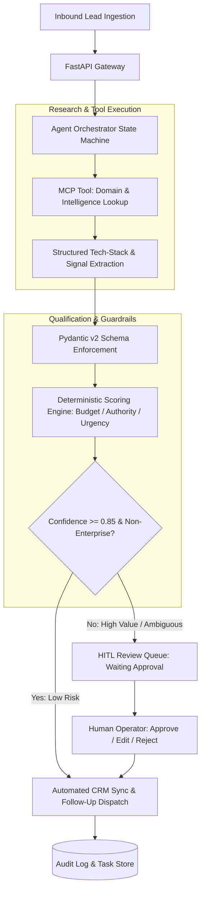

# Autonomous Lead Agent & Workflow Engine

[]()
[]()
[]()
[]()
[](LICENSE)

A production-grade autonomous B2B revenue intelligence and lead qualification agent. Built with **FastAPI**, **Pydantic v2**, and **Model Context Protocol (MCP)** tool execution, featuring deterministic state-machine orchestration and **Human-in-the-Loop (HITL)** approval gates for mission-critical external actions.

---

## 🏗 Architecture Overview



---

## 🌟 Key Capabilities

1. **Model Context Protocol (MCP) Integration:** Extensible async tool client for dynamic research, domain intelligence, and firmographic enrichment.
2. **Strict Schema Enforcement:** 100% typed structured outputs via Pydantic v2, eliminating JSON hallucination and format errors.
3. **Human-in-the-Loop (HITL) Safety Gate:** High-value enterprise deals ($ \ge 80 $ score) or low-confidence assessments are automatically routed to a stateful review queue before any external outreach is triggered.
4. **Deterministic State Machine:** Prevents infinite cyclic loops, enforces timeouts, and provides idempotent task recovery.
5. **Production Ready:** Complete with Dockerfile, Docker Compose, asynchronous endpoints, and unit test suite.

---

## ⚙️ Engineering Trade-Offs

| Decision | Chosen Approach | Alternative Considered | Rationale |
|---|---|---|---|
| **Agent Framework** | Custom Async State Machine + Pydantic | Unconstrained ReAct Loops | LangChain/AutoGPT-style loose loops introduce non-deterministic token burn and infinite loop risks in production. Explicit state transitions guarantee SLA and auditability. |
| **Output Validation** | Pydantic v2 Strict Models | Free-form Markdown / Regex parsing | High-stakes CRM integrations require 100% schema compliance. Malformed payloads are intercepted at the model boundary. |
| **Outreach Safety** | HITL Approval Gate | Fully Autonomous Email Dispatch | Accidental hallucinated claims in enterprise B2B sales ruin reputation. Human oversight for top-tier leads provides safety without sacrificing speed. |

---

## 🚀 Quickstart

### Option 1: Docker Compose (Recommended)

```bash
docker-compose up --build
```
The service will be live at `http://localhost:8000`. Interactive OpenAPI documentation is available at `http://localhost:8000/docs`.

### Option 2: Local Setup

```bash
python -m venv venv
source venv/bin/activate  # On Windows: .\venv\Scripts\activate
pip install -r requirements.txt

uvicorn src.main:app --reload --port 8000
```

---

## 📡 API Reference

### 1. Ingest Lead (`POST /api/v1/leads/process`)
Triggers autonomous research, qualification, and routing.

```bash
curl -X POST "http://localhost:8000/api/v1/leads/process" \
     -H "Content-Type: application/json" \
     -d '{
       "name": "Sarah Connor",
       "email": "sarah@cyberdyne.ai",
       "company_name": "Cyberdyne AI Systems",
       "website": "https://cyberdyne.ai",
       "inquiry_message": "Need urgent automation of inbound enterprise lead qualification."
     }'
```

### 2. Check Pending Approvals (`GET /api/v1/tasks/pending-approvals`)
Lists all tasks held in the human review queue.

### 3. Submit Decision (`POST /api/v1/tasks/{task_id}/decision`)
Approve, modify, or reject a queued task.

```bash
curl -X POST "http://localhost:8000/api/v1/tasks/task_abc123/decision" \
     -H "Content-Type: application/json" \
     -d '{
       "action": "approve",
       "feedback": "Verified ICP fit."
     }'
```

---

## 🧪 Testing

Run the test suite with:

```bash
pytest tests/ -v
```

---

## 📄 License

MIT © [Marwane Elhour](https://github.com/Marwanelh)
