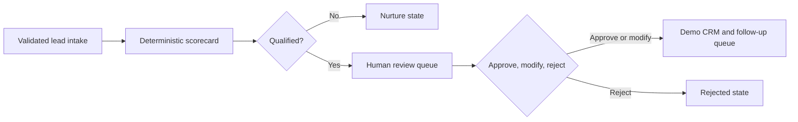

# Lead Workflow Engine

A runnable FastAPI reference implementation for inbound lead qualification, routing, and human review.

This portfolio project demonstrates the engineering patterns behind business automation systems without exposing client source code, data, or proprietary workflows. It uses synthetic examples and local demo integrations only.

## What it demonstrates

- Validated lead intake with Pydantic models
- Transparent, deterministic scoring with recorded evidence
- Routing into high-priority, qualified, and nurture tiers
- A mandatory human approval gate before qualified follow-up
- Approve, modify, and reject decisions
- Async-safe in-memory task storage
- A local CRM/follow-up adapter that records intent without contacting anyone
- FastAPI endpoints, Docker packaging, and automated tests

## Workflow



The scorecard intentionally explains its inputs and missing information. The service never presents guessed company data as fact and never sends external messages.

## Run locally

```bash
python -m venv .venv
# Windows: .venv\Scripts\activate
# macOS/Linux: source .venv/bin/activate
pip install -r requirements.txt
uvicorn src.main:app --reload
```

Open `http://localhost:8000/docs` for the interactive API documentation.

Docker is optional:

```bash
docker compose up --build
```

## Example request

```bash
curl -X POST http://localhost:8000/api/v1/leads/process \
  -H "Content-Type: application/json" \
  -d '{
    "name": "Jordan Smith",
    "email": "jordan@example.com",
    "company_name": "Example Education Group",
    "website": "https://example.com",
    "company_size": "enterprise",
    "contact_role": "Operations Director",
    "inquiry_message": "Our admissions workflow is blocking response times and needs an urgent automation review."
  }'
```

Useful endpoints:

| Method | Endpoint | Purpose |
|---|---|---|
| `POST` | `/api/v1/leads/process` | Validate, score, and route a lead |
| `GET` | `/api/v1/tasks/pending-approvals` | List leads waiting for review |
| `GET` | `/api/v1/tasks/{task_id}` | Read current task state |
| `POST` | `/api/v1/tasks/{task_id}/decision` | Approve, modify, or reject |
| `GET` | `/health` | Service health check |

## Engineering decisions

**Deterministic scoring for the demo.** A reviewer can trace every result to supplied input. In a real system, an AI enrichment provider could contribute evidence, but its output should remain validated and reviewable.

**Human review before follow-up.** Qualified leads pause before any downstream action. This prevents unreviewed or inaccurate messages from reaching people.

**Integration boundary without fake services.** The demo connector creates stable local records and an audit log. It does not claim to connect to HubSpot, SendGrid, or another vendor.

**In-memory storage.** This keeps the project easy to run. Data resets when the process restarts; a production deployment would replace the repository with persistent storage.

## Tests

```bash
pytest -q
```

The tests cover scoring and routing, approval, modification validation, missing information, API route precedence, and request validation.

## Scope

This is an independent portfolio project. It contains no FillFlow code, client names, client data, private prompts, or production credentials.

## Author

[Marwane Elhour](https://github.com/Marwanelh) · [LinkedIn](https://www.linkedin.com/in/marwanelh/)
